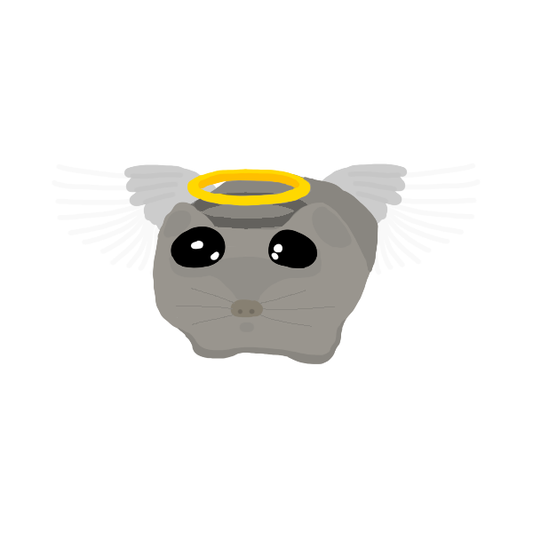
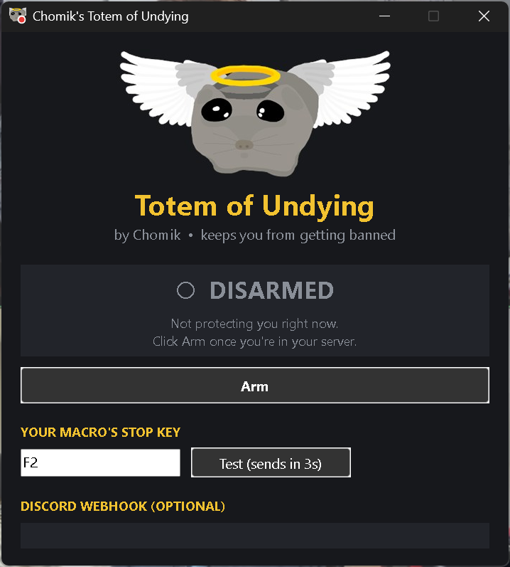

  

<h1 align="center">Chomik's Totem of Undying</h1>

<b>Keeps you from getting banned from hunt servers in Sol's RNG.</b>

When you join a Sol's RNG server that isn't your own private server (a hunt server, a friend's server or a public server), the totem instantly presses your biome macro's **stop key**. That way your macro (MultiScope or any other) can't post biomes from someone else's server.

> **Vibe coded:** this program was made with an AI assistant (Claude) by describing what it should do, then testing and adjusting it. It works well for me, but please read the [Good to know](#good-to-know) section before relying on it.

  

## Download

Get **`ChomiksTotem.exe`** from the [Releases](../../releases) page. It's a single file, so there's nothing to install or unzip.

## How to use

1. Start your biome macro the way you normally do.
2. Open **ChomiksTotem.exe**.
3. Click the **stop key** box and press the key that **stops** your macro.
4. Press **Test**. After a 3-second countdown the totem presses that key. Check that your macro actually stopped.
5. Join **your own** private server and click **Arm**. The totem remembers that this server is yours.

From now on, whenever you join a server that isn't yours, the totem pops and stops your macro. After it pops, go back to your server and click **Re-arm**.

## Status colours

The totem's icon in the taskbar, the title bar and the tray shows a dot:

| Dot | Meaning |
|---|---|
| 🔴 Red | Disarmed: not protecting you |
| 🟢 Green | Armed: watching for server changes |
| 🟡 Yellow | Popped: your macro was stopped, so re-arm when you're back in your server |

## Discord webhook (optional)

Paste a Discord webhook URL into the box and the totem posts a message when it pops, plus one when you press Test.

## How it works

The totem only **reads** files. It never touches Roblox or the game:

- **Roblox's log files** (`%LOCALAPPDATA%\Roblox\logs`) show when you join a server, and for most joins which private server it is.
- **The Roblox launch command** tells it which server a new Roblox window is joining when you open a link in your browser. It checks this before you're even in the server.

If the server doesn't match yours, it presses your stop key once.

## Good to know

- **Use a key that stops your macro.** If your macro uses one key to both start and stop, the totem could switch it *on*.
- **Clicking a share link while Roblox is already open** usually gives the totem no way to tell whose server it is, so it may pop even if it's your own link. Just re-arm.
- **Windows SmartScreen or your antivirus may warn about the exe.** That's common for new programs that aren't signed, and especially for ones made with AutoHotkey. The full source code is in this repository if you'd rather read it or build it yourself.
- **Settings** are saved in `%APPDATA%\Chomik's Totem\settings.ini`. Delete that file to reset everything, including which server is yours.

## Building from source

1. Install [AutoHotkey v2](https://www.autohotkey.com/).
2. Run `ChomiksTotem.ahk` directly, or compile it into an exe with Ahk2Exe (included with AutoHotkey), using the v2 `AutoHotkey64.exe` as the base.
3. Keep `angel.ico`, `logo.jpg` and `icon.png` next to the script. They get built into the exe.

## Disclaimer

This is a fan-made tool. It isn't affiliated with Roblox or Sol's RNG, and you use it at your own risk.

## License

[MIT](LICENSE). Artwork: hand-drawn Angel Chomik by Chomik.
